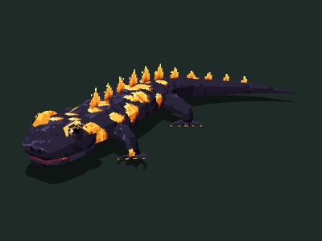
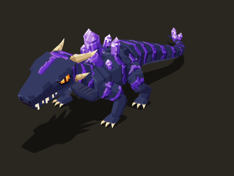
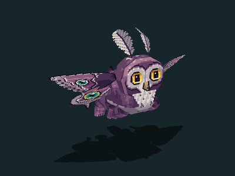
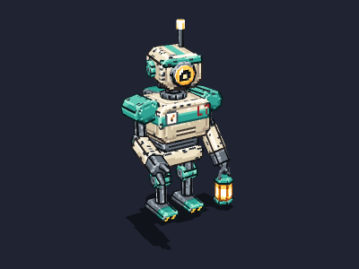
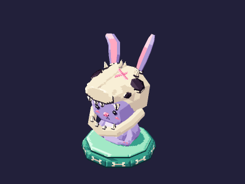
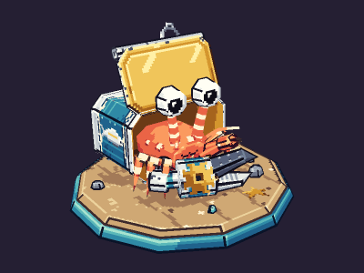
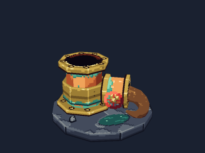
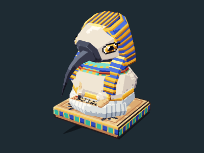
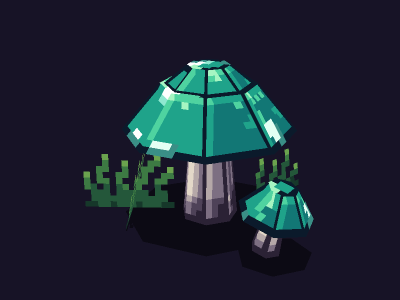
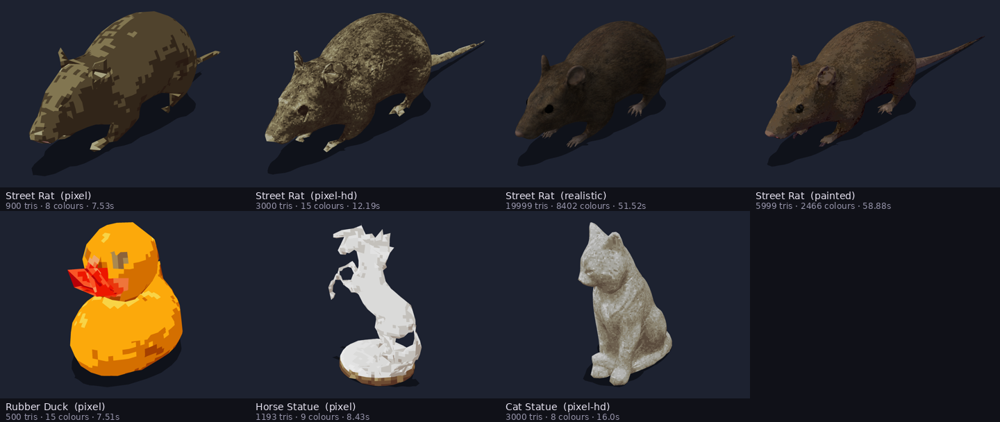

# lowpix

**A code-first low-poly modeller, rigger and animator with procedurally hand-painted pixel-art textures, built to be driven by AI agents. It can also convert any detailed model into the same style in one command.**

You describe a model as JSON: smooth lofted tubes for organic forms, chamfered boxes and prisms
for hard surfaces, and alpha-cut cards, in a pivot hierarchy, plus colour ramps and paint layers. lowpix then builds the geometry, packs a
texture atlas at a uniform texel density, and *paints* every texel. The painting covers
lighting, edge rims, beveled markings, gloss dashes and hand-placed pixel stamps,
quantised to a strict palette. It also renders previews for the agent to look at
and exports a validated glTF, OBJ and Blockbench file.


### The rigged and animated collection

Every model is a single JSON spec in [`examples/`](examples/), rigged (one joint per part, with
chain lofts for spines and tails) and animated. Clips are baked into each `.glb`.

| | | |
|---|---|---|
|  |  |  |
| **Ember Salamander**: idle, walk | **Geode Drake**: idle, roar, prowl | **Duskmoth Griffin**: idle, fly, headturn |
|  |  |  |
| **Lamplighter Bot**: idle, wave, walk | **Rex-Hood Bunny**: idle, chomp, peek | **Tin Hermit**: idle, snap, hide |
|  |  |  |
| **Pipe Otter**: popup, idle, wave | **Ibis Scribe**: idle, write, bow | **Glowcap Mushroom**: idle, boing |

The creatures and gacha-style figures were inspired by reference concepts (a crystal dragon, an
owl hybrid, capsule-toy lines) but are original designs, not copies. All are CC0.

### Convert any detailed model, in four styles



```bash
python -m lowpix polyhaven rat
```

```bash
python -m lowpix convert polyhaven:street_rat --style pixel -o out/rat
```

The first command searches Poly Haven's CC0 models. `--style` is `pixel`, `pixel-hd`, `painted` or `realistic`.

The pipeline uses feature-preserving quadric decimation, seamless chart unwrapping, exact
closest-point texture transfer, then per-style shading. It works on any `.glb`, `.gltf` or
`.obj`. `pixel` gives the house pixel-art style. `pixel-hd` is high-resolution pixel art.
`painted` is smooth and hand-painted. `realistic` gives a high-res texture, a lit PBR material and
smooth normals, i.e. a game-ready LOD. See [`docs/CONVERT.md`](docs/CONVERT.md). The set above
is reproducible with `python -m lowpix batch examples/converted/manifest.json -o examples/converted`.
Source models are CC0 from [Poly Haven](https://polyhaven.com).

### Mass production

```bash
python -m lowpix batch "polyhaven?statue" --limit 12 --style painted -o out/statues
```

```bash
python -m lowpix batch my_models/ examples/*.json --style pixel-hd -j 4 -o out/set
```

Mix specs, model files, folders, globs, Poly Haven searches and manifests with per-item
options. Items run in parallel, and failures are recorded without stopping the batch. You get
`summary.json`/`.csv`, a `contact.png` of every result and an `index.html` gallery that plays each
`.glb` and its clips. See [`docs/BATCH.md`](docs/BATCH.md).

### Give the repo to Claude

[`CLAUDE.md`](CLAUDE.md) maps each kind of request to its route: convert, batch, or a
`python -m lowpix new <template> "<Name>"` spec to rig and animate. The `.mcp.json` MCP
server returns images to the agent at every step. Open the repo in Claude Code and ask for
what you want.

## Why it's built for agents

Agents can't drag vertices in a viewport, but they are good at writing structured text
and critiquing images. lowpix closes that loop:

* **Declarative JSON specs** that are easy to diff and patch, with styles and id-addressable layers.
* **Precise validation**: errors and warnings name the part, the layer and the fix
  (`below ground plane y=0: shin(-0.49)`, `stamp 0 chars ['z'] missing from key`).
* **It sees what it made**: every build renders a contact sheet (hero, front, side, top and back
  views, atlas, palette and stats). `render --part head` gives pixel-level close-ups.
* **An MCP server** (`.mcp.json` included) whose tools return those images straight into the
  agent's context: `lowpix_build`, `lowpix_render`, `lowpix_animate` (filmstrips of a clip),
  `lowpix_convert`, `lowpix_batch`, `lowpix_polyhaven_search`, `lowpix_texture`, `lowpix_ramp`, `lowpix_guide`.
* **Animation it can judge**: filmstrips show timing and arcs as one image, and `lint` samples
  every clip for feet sinking through the floor.
* **Cheap realism**: `convert` turns an existing detailed model into any of four styles in one call
  instead of thousands of tokens of hand-modelling, and `batch` does it for whole sets in parallel.
* **Stable randomness**: pattern seeds key on layer ids, so iterating doesn't reshuffle the art.
* **Genre knowledge built in**: [`docs/STYLE_GUIDE.md`](docs/STYLE_GUIDE.md) breaks the look down
  into rules, each mapped to a feature, and ends with a critique checklist.

## Quick start

```bash
pip install numpy pillow            # the only dependencies
```

```bash
python -m lowpix build examples/salamander.json -o out/salamander --gif
```

```bash
python -m lowpix render examples/salamander.json -o head.png --part head --yaw 30 --pitch 24
```

```bash
python -m lowpix ramp "#e2701a" --steps 7
```

```bash
python -m unittest discover -s tests -v
```

View a GLB in a browser (three.js, nearest filtering, unlit):

```bash
python -m http.server 8000
```

Then open `http://localhost:8000/viewer/?model=../examples/output/ember_salamander.glb`, or drop
any `.glb` onto the page.

### Use it from Claude Code

The repo's `.mcp.json` registers the `lowpix` MCP server (`python3 -m lowpix.mcp_server`). Open
the repo in Claude Code, approve the server, and ask something like *"Use lowpix to model a
low-poly pixel-art frog; iterate until the critique checklist passes."* The
[`lowpix-modeling` skill](.claude/skills/lowpix-modeling/SKILL.md) gives the agent the workflow.

## What's in the box

| | |
|---|---|
| Shapes | `loft` (smooth tubes through control rings: Catmull-Rom subdivision, rounded or chamfered profiles, parallel-transport frames), `box`/`taper` with optional `chamfer`, `prism` (n-gon cylinders with tapered caps), `card` (double-sided alpha cut-outs from ASCII art) |
| Animation | clips of keyframes (ease/smooth/back/elastic/step), oscillators (sine/bounce/square/pulse), `wave` chains with lag and growth (overlap and follow-through), squash and stretch via scale, mirror-phased gaits. Baked to glTF clips, GIFs and filmstrips |
| Converter | `.glb`/`.gltf`/`.obj` or `polyhaven:<id>` → quadric-decimated, chart-unwrapped, closest-point re-baked model in `pixel`, `pixel-hd`, `painted` or `realistic` (lit PBR) style |
| Production | `batch` (parallel, mixed sources, manifests, summary, contact grid, HTML gallery), `new` (spec templates), batched software rasteriser for high-poly previews |
| Rigging | every part is a joint at its pivot, `chain` lofts split into posable segments, `bone` (empty joint), pivot hierarchy, Euler rotations, `attach` (stick parts onto a loft's curved surface by path position and angle), `mirror` (whole subtrees, correct on asymmetric bodies, images stay un-flipped), `orient: "world"` for limbs, `snap_ground` for feet, `hide` for buried faces |
| Painting | hue-shifted ramps, tone-space shading, painted key light, local gradient, ground occlusion, lit and dark edge rims, outlines, `band`, `stripes` (can follow a loft's path), `spots` (3D, wrapping, tapering), `patches`, `noise`, `gradient`, `speckle`, `gloss` (wet dashes), hard-surface `panel`, `rivets`, `wear`, `grille`, `rect`, pattern `bevel`s, ASCII `stamps`, Bayer dithering |
| Output | `.glb` (unlit, nearest, alpha mask, node per part, passes the Khronos validator), `.obj/.mtl`, `.bbmodel` (experimental), PNG atlas, hero, contact sheet, turntable GIF, JSON report |
| Agent I/O | CLI, Python API, MCP server, JSON Schema (`python -m lowpix schema`) |

Docs: [spec reference](docs/SPEC.md) (incl. rigging and animation) · [style guide](docs/STYLE_GUIDE.md) (incl. animation principles) · [agent workflow](docs/AGENT_WORKFLOW.md) · [converter](docs/CONVERT.md) · [batch](docs/BATCH.md)

## About the reference and originality

The request was to clone the *Salamander* model from Sketchfab's
[Low poly & pixel art texture](https://sketchfab.com/bevanmckechnie/collections/low-poly-pixel-art-texture-31f061f8de2546fa99e876385ed6d0aa)
collection. That model belongs to its artist (GurgleNurgle), is not downloadable, and carries
no licence. Several of the same artist's models are tagged `noai`. So lowpix does **not** copy it.
Instead, the *genre* (Blockbench-style low poly, unlit, hand-painted pixel textures) was studied from
public preview images (the salamander and a few of the collection's robots, none tagged `noai`) and
turned into the general rules and tools above. Ember Salamander and Lamplighter Bot are original
designs made with them. Please treat other artists' models the same way.

## Status

* glTF output is checked with the Khronos glTF validator (0 errors, 0 warnings) and renders
  identically in three.js.
* `.bbmodel` export follows Blockbench's generic-model format but hasn't been opened in
  Blockbench yet. Treat it as experimental. The `.obj` imports into Blockbench and Blender.
