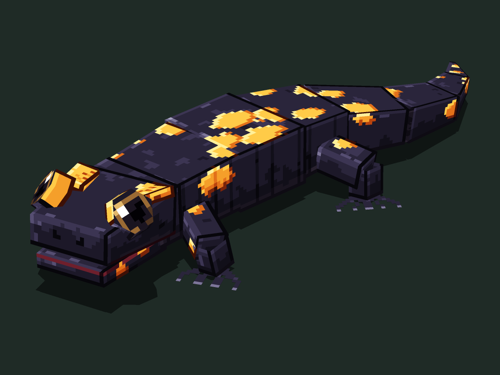
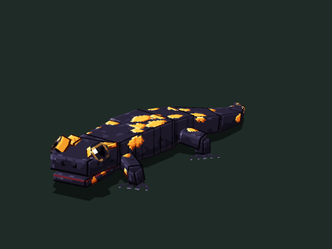
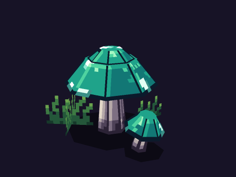

# lowpix

**A code-first low-poly modeller with procedurally hand-painted pixel-art textures, built to be driven by AI agents.**

You describe a model as JSON: boxes, tapered boxes, prisms and alpha-cut cards in a
pivot hierarchy, plus colour ramps and paint layers. lowpix then builds the geometry, packs a
texture atlas at a uniform texel density, and *paints* every texel. The painting covers
lighting, edge rims, beveled markings, gloss dashes and hand-placed pixel stamps,
quantised to a strict palette. It also renders previews for the agent to look at
and exports a validated glTF, OBJ and Blockbench file.



| turntable | second example, same tool |
|---|---|
|  |  |

*Ember Salamander* (236 tris, 28 colours) and *Glowcap Mushroom* (106 tris, 21 colours)
are original designs, CC0.

## Why it's built for agents

Agents can't drag vertices in a viewport, but they are good at writing structured text
and critiquing images. lowpix closes that loop:

* **Declarative JSON specs** that are easy to diff and patch, with styles and id-addressable layers.
* **Precise validation**: errors and warnings name the part, the layer and the fix
  (`below ground plane y=0: shin(-0.49)`, `stamp 0 chars ['z'] missing from key`).
* **It sees what it made**: every build renders a contact sheet (hero, front, side, top and back
  views, atlas, palette and stats). `render --part head` gives pixel-level close-ups.
* **An MCP server** (`.mcp.json` included) whose tools return those images straight into the
  agent's context: `lowpix_build`, `lowpix_render`, `lowpix_texture`, `lowpix_ramp`, `lowpix_guide`.
* **Stable randomness**: pattern seeds key on layer ids, so iterating doesn't reshuffle the art.
* **Genre knowledge built in**: [`docs/STYLE_GUIDE.md`](docs/STYLE_GUIDE.md) breaks the look down
  into rules, each mapped to a feature, and ends with a critique checklist.

## Quick start

```bash
pip install numpy pillow            # the only dependencies
```

```bash
python -m lowpix build examples/salamander.json -o out/salamander --gif
```

```bash
python -m lowpix render examples/salamander.json -o head.png --part head --yaw 30 --pitch 24
```

```bash
python -m lowpix ramp "#e2701a" --steps 7
```

```bash
python -m unittest discover -s tests -v
```

View a GLB in a browser (three.js, nearest filtering, unlit):

```bash
python -m http.server 8000
```

Then open `http://localhost:8000/viewer/?model=../examples/output/ember_salamander.glb`, or drop
any `.glb` onto the page.

### Use it from Claude Code

The repo's `.mcp.json` registers the `lowpix` MCP server (`python3 -m lowpix.mcp_server`). Open
the repo in Claude Code, approve the server, and ask something like *"Use lowpix to model a
low-poly pixel-art frog; iterate until the critique checklist passes."* The
[`lowpix-modeling` skill](.claude/skills/lowpix-modeling/SKILL.md) gives the agent the workflow.

## What's in the box

| | |
|---|---|
| Shapes | `box`, `taper` (scaled/shifted ends, wedges), `prism` (n-gon cylinders with tapered caps), `card` (double-sided alpha cut-outs from ASCII art) |
| Rigging | pivot hierarchy, Euler rotations, `mirror` (whole subtrees, images stay un-flipped), `orient: "world"` for limbs, `snap_ground` for feet, `hide` for buried faces |
| Painting | hue-shifted ramps, tone-space shading, painted key light, local gradient, ground occlusion, lit and dark edge rims, outlines, `band`, `stripes`, `spots` (3D, wrapping), `patches`, `noise`, `gradient`, `speckle`, `gloss` (wet dashes), pattern `bevel`s, ASCII `stamps`, Bayer dithering |
| Output | `.glb` (unlit, nearest, alpha mask, node per part, passes the Khronos validator), `.obj/.mtl`, `.bbmodel` (experimental), PNG atlas, hero, contact sheet, turntable GIF, JSON report |
| Agent I/O | CLI, Python API, MCP server, JSON Schema (`python -m lowpix schema`) |

Docs: [spec reference](docs/SPEC.md) · [style guide](docs/STYLE_GUIDE.md) · [agent workflow](docs/AGENT_WORKFLOW.md)

## About the reference and originality

The request was to clone the *Salamander* model from Sketchfab's
[Low poly & pixel art texture](https://sketchfab.com/bevanmckechnie/collections/low-poly-pixel-art-texture-31f061f8de2546fa99e876385ed6d0aa)
collection. That model belongs to its artist (GurgleNurgle), is not downloadable, and carries
no licence. Several of the same artist's models are tagged `noai`. So lowpix does **not** copy it.
Instead, the *genre* (Blockbench-style low poly, unlit, hand-painted pixel textures) was studied from
public preview images and turned into the general rules and tools above. Ember Salamander is an
original design made with them. Please treat other artists' models the same way.

## Status

* glTF output is checked with the Khronos glTF validator (0 errors, 0 warnings) and renders
  identically in three.js.
* `.bbmodel` export follows Blockbench's generic-model format but hasn't been opened in
  Blockbench yet. Treat it as experimental. The `.obj` imports into Blockbench and Blender.
