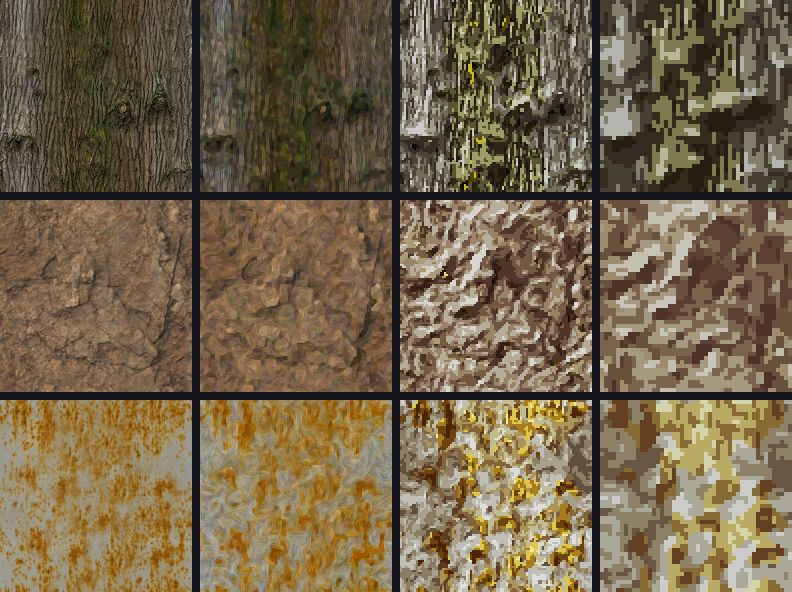

# Photo-bashing

Photo-bashing pulls real photo textures into the art. It can give realistic results, or stylise a photo into
hand-painted or pixel-art textures with the brush engine. Poly Haven's textures are CC0, and lowpix reads them
straight from its API. You can also use your own photos if you have the rights to them.



Each row is one photo (bark, rock, rusty metal). The columns are `realistic`, `painted`, `pixel-hd` (96 px) and `pixel` (48 px).

## Commands

```bash
python -m lowpix photo search moss
```

```bash
python -m lowpix photo polyhaven:rock_face_03 --style pixel-hd --size 64
```

```bash
python -m lowpix photo my_photo.jpg --style painted --size 512
```

```bash
python -m lowpix photo vendor bark_brown_02 --dest assets/photos
```

* `search` lists matching Poly Haven textures.
* A plain source stylises one photo. It writes a tileable texture plus an NxN tiled preview (`--preview`) so you can check the seams.
* `vendor` saves a small offline copy (`diff`, `nor`, `ao`, plus `source.json`) for use in specs.

MCP: `lowpix_photo` takes `source` (or `query` to search), `style` and `size`.

## Styles

| style | how |
|---|---|
| `realistic` | The photo, relit by its own normal and AO maps (stock-photo look). Made tileable if it isn't already. |
| `painted` | Kuwahara flattening into painted shapes, then brush strokes along the photo's structure (structure-tensor flow), then a light posterise and a saturation lift. |
| `pixel-hd` | Normal-map relief lighting blended with albedo, ranked onto hue-shifted ramps extracted from the photo (k-means hue families), quantised as strokes, then despeckled. |
| `pixel` | The same at chunky sizes, with stronger simplification and fewer colours. |

## Photos inside models and sprites

* 3D paint op: `{"op": "photo", "src": "assets/photos/rock_face_03", "scale": 10, "amount": 1.1, "ramps": ["stone"]}`.
  It is planar-projected per face and continuous across faces.
  * `mode: "detail"` (default) adds the photo's relief to the painted tone, so the result stays on your ramps and in your style.
  * `mode: "colour"` paints the photo's own colours, shaded by the painted light (with `relight`, `tint` and `shade`), for a realistic finish.
* Sprite material: `"photo": {"src": ..., "scale": 32, "amount": 1.2}` adds the photo's relief to the material's tone.

`assets/photos/` ships five CC0 textures from Poly Haven (bark, rock, leather, leaves, rusty metal), downscaled for
offline use. `examples/thornhide_behemoth.json` uses three of them.
