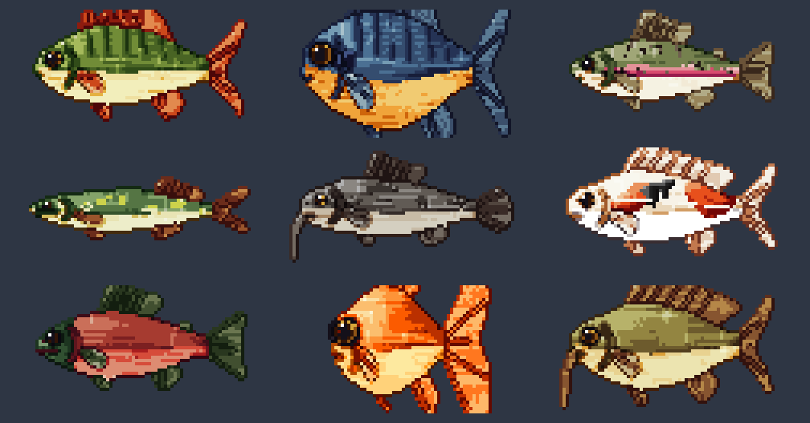
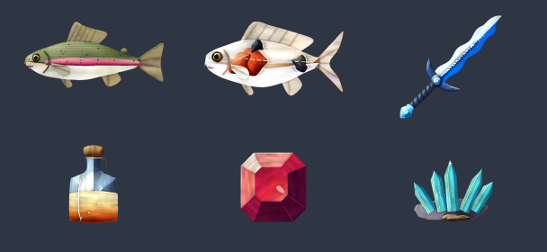

# 2D sprites

lowpix also makes 2D art: item icons, weapons, gems, ores, fish, potions. You can use
the generators or write a sprite spec by hand. Every sprite is painted with brush strokes
that follow its form, so pixel clusters come out as elongated, interlocking marks like a
pixel artist's, not smooth computed bands.



## Quick start

```bash
python -m lowpix sprite fish --param species=koi --size 80x40 --scale 4
```

```bash
python -m lowpix sprite sword --count 12 --seed 7 --scale 3
```

```bash
python -m lowpix sprite gem --param cut=heart --param colour=ruby --paint painted --size 96
```

```bash
python -m lowpix sprite my_icon.json --scale 6
```

* `--count N` makes a sheet of seeded variations.
* `--scale k` also writes a nearest-neighbour preview.
* Every PNG gets a `.json` beside it with the full spec, so you can edit it and render it again.

MCP: `lowpix_sprite` takes a `generator` or an inline `spec`, plus `seed`, `count`, `size`, `paint` and `params`. It
returns the image and the spec.

## Generators (`lowpix/sprite_gen.py`)

| generator | options (`--param k=v`) | what you get |
|---|---|---|
| `fish` | `species`: perch, bluegill, trout, pike, catfish, koi, salmon, goldfish, carp | Spline body built from dorsal and ventral profiles. Spiny or soft dorsal fins, adipose fin, rayed tail (fork, square, round or veil). Gill cover with a lit lip, lips, nostril, eye with iris, pupil and catch-light. Species markings: bars, spots, a lateral band, koi patches, mottling, barbels. Scale texture and a dashed lateral line. |
| `sword` | `theme`: steel, frost, ember, void, verdant, obsidian, bone, royal; `tip`, `edge`, `guard`, `curve` | Curved blade outline (leaf, clip, spear, broad, sabre curve) with a ridge, a lit edge line, a fuller, scratches, nicks or serration, runes or a vine. Hand-drawn quillons (cross, curled, swept, wings, disc), a gem boss, a leather-wrapped grip, and a faceted or bulb pommel. |
| `gem` | `cut`: round, oval, cushion, emerald, pear, trillion, marquise, heart, hexagon, princess; `colour`: a hex or a stone name (ruby, sapphire, emerald, amethyst, topaz, citrine, aquamarine, diamond, onyx, rose, peridot, garnet) | Crown facets, a refracting table that is darker toward the light, star-facet lines, an inner glint and a sparkle. |
| `ore` | `kind`: ore, crystal, nugget, ingot, chunk; `colour` | Faceted rock with mineral chips; hexagonal crystal prisms with three-face shading, a lit edge and cleavage streaks; pitted nuggets; a cast ingot with a stamp. |
| `potion` | `shape`: round, flask, vial, bottle; `colour` | Revolved glass silhouette, liquid with a meniscus, bubbles, a reflection streak, and a cork tied with string. |

Generators return ordinary specs, so `make()`/`make_sheet()` in Python, or the CLI, can render any edited copy.

## Paint modes (`"paint"`)

| mode | look |
|---|---|
| `strokes` (default) | Pixel art painted with strokes. Light gives a target tone, then the brush engine smears it along the form's flow and breaks it into stroke streaks before quantising to the ramp. Material `texture` marks are added as short strokes. Strictly on-palette. |
| `flat` | Per-pixel quantised light (clean and mechanical). Add `dither` for Bayer dithering. |
| `painted` | Smooth hand-painted art at any size. It is supersampled (`supersample`, default 4), then painted as a block-in smear, stroke-to-stroke value and hue variation, bristle streaks, and crisp detail at edges. It finishes with a soft painted outline. Tune with `"brush": {"length", "width", "value", "hue", "bristle"}`. |



## Sprite spec

```json
{"size": [32, 32], "view": {"rotate": 45}, "paint": "strokes",
 "materials": {"steel": {"base": "#a9b6c6", "steps": 8, "spec": 1, "texture": "metal"},
               "gold": {"base": "#d2a542", "steps": 7}},
 "shapes": [
   {"type": "polygon", "points": [[15,2],[17,2],[17,22],[15,22]], "material": "steel", "form": "ridge",
    "part": "blade", "edge": {"light": 2, "dark": -1}},
   {"type": "ellipse", "center": [16,25], "radii": [3,2], "material": "gold", "form": "dome", "part": "pommel"}],
 "outline": "selout", "effects": {"sparkle": "auto"}}
```

The top-level keys are:

* `size`
* `view`: `rotate` (degrees), `scale`, `offset`, `center`. Shapes are drawn in local space and then rotated, so a sword can be designed upright and shown diagonal.
* `paint`
* `light`: a 3D direction, default upper-left.
* `outline`: `selout` (lit side lighter), `black` or `none`. Also `outline_color` and `outline_corners`.
* `inner`: contact shading where parts overlap; `shade` or `none`.
* `strokes`: pixel-mode brush settings `length`, `rough`, `overshoot`, `width` and `marks`.
* `brush`: painted-mode settings.
* `cleanup`
* `effects`: `glow` `{color, radius, alpha}`, `shadow`, and `sparkle` (`"auto"` or points).

**Materials** each have the following keys:

* `base` + `steps` (a hue-shifted ramp: `hue_shift`, `sat_shift`, `spread`), or an explicit `ramp`.
* Light response: `contrast`, `tone` (midpoint), `rim` (reflected light on the shadow-side silhouette), `spec` +
  `spec_threshold` (specular dabs), and `emissive` (+ `glow_gradient`).
* Surface texture: `noise`/`noise_scale` and `dither`.
* `texture`: brush marks, one of metal, wood, stone, leather, cloth, crystal, organic, scales, moss, fur, liquid.
* `photo`: photo-bashed relief, `{"src": "assets/photos/rock_face_03", "scale": 32, "amount": 1.2}`.
* `strokes`: per-material brush settings.

**Shapes** (`type`):

* `polygon` (`points`): forms `flat`, `dome`, `bevel`/`pillow` (`bevel` width), and `ridge` (`axis`, `tilt`).
* `ellipse` (`center`, `radii`, `angle`): forms `dome`, `bevel`.
* `stroke` (`points`, `width` scalar or per point): a tapered tube; forms `cylinder`, `ridge`.
* `gem` (`outer`, `table` or `table_scale`/`table_offset`, `tilt`, `refraction`): facets that point outward.
* `pixels` (`at`, `art` rows, `key` char → `#hex` or `material:index`): hand-placed pixels, drawn last.

Every shape also takes these keys:

* `part`: contact shading and strokes respect part boundaries.
* `z`: draw order.
* `material`, `bias`: tone offset.
* `grad` `{from, to, amount}`.
* `stripes` `{from, to, period, duty, amount, slant}`.
* `scales` `{size, amount}`.
* `edge` `{light, dark, width}`: painted edge highlight and shadow.
* `clip`: only where these parts are already drawn.
* `subtract`
* `flow` `[dx, dy]`: the direction strokes run. The default comes from the form: along a ridge or stroke, around a dome, along a bevelled edge.

## How the brush works (`lowpix/brush.py`)

All the brush tools are built on line-integral convolution along a flow field. It is vectorised, so a 1024² texture paints in about a second.

* `stroke_field` makes random strokes of a given length and width that run along the flow.
* `quantise` (pixel art) smears the lit tone along the flow, offsets it by stroke streaks, quantises it to the ramp,
  and then adds texture marks.
* `painted` (smooth) builds up a block-in smear, stroke value and hue variation, bristles, and crisp edges.

The 3D painter uses the same `quantise`. Add `"brush": {...}` to a model spec or style (see SPEC.md) and its texture
atlas is painted in strokes too.
