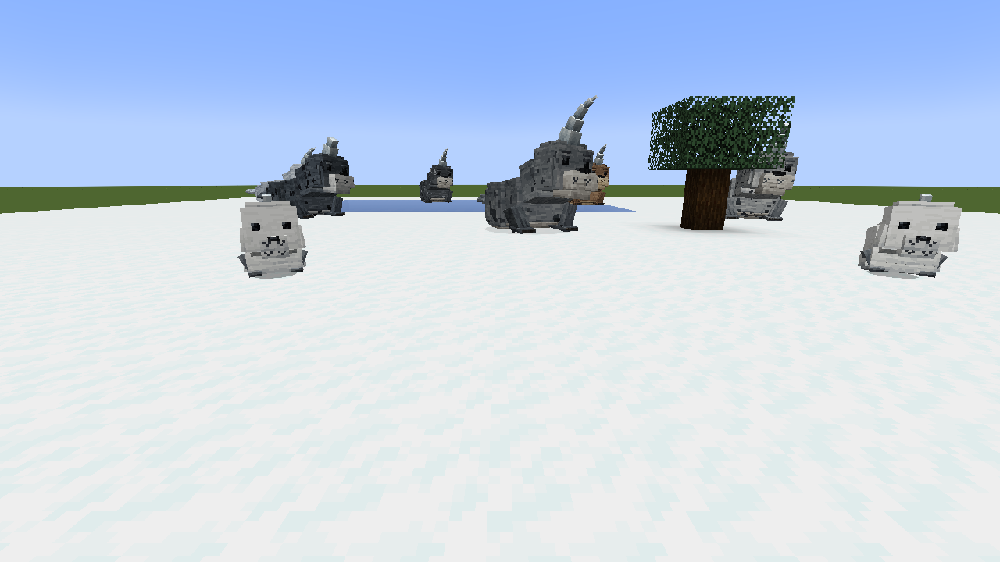
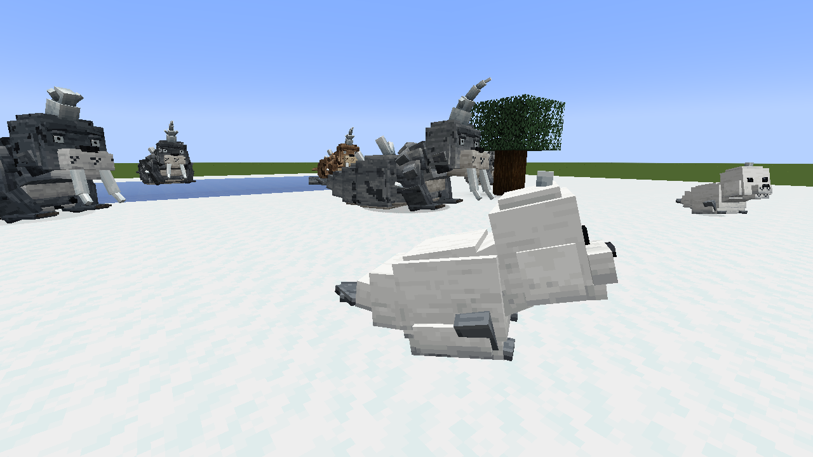

# Winterworks

A winter contraptions mod for Minecraft Java 1.21.1 (Fabric). Every model, texture and animation is made with
[lowpix](../../README.md) and exported with `python -m lowpix mc export` (docs/MINECRAFT.md).

## Content

**Snowball Launcher.** A homemade rapid-fire snowball gatling of iron, redstone and a blaze rod. Hold use to fire packed
snowballs that briefly stun (dizzy stars). Sneak + use switches to cobblestone balls, which charge for a second and hit
hard with recoil. There is no HUD: the hopper on top is the magazine. You can see the 6 snowballs (or 3 cobble balls)
in it; firing pops them off the top, they drop back in one at a time when you stop, and an empty hopper still fires
from your pockets at half rate. Swapping ammo tips the hopper back, throws the old load out (into your inventory) and
drops the new one in. Heat shows on the gun: the gauge needle climbs, the vent opens, the barrels glow orange then
red-hot, the muzzle smokes, and at 100 it overheats, judders and vents steam until it cools.
Recipe: redstone, hopper, redstone / iron, dispenser, iron / iron, blaze rod, iron.

**Icebreaker.** A huge, fat, monstrous seal of frozen rivers, plains and coasts: a long segmented body, a shaggy fur mane,
ice-armour shards on its back, great curved ice tusks, a jagged ice horn and big fins, in six coats (grey, harbour,
leopard, ringed, brown, frost) picked by biome and inherited by cubs. Its face is expressive: blinking lids, heavy
brows that knit when it's angry, flaring nostrils, a bark on every grunt. About one adult in twelve is an
**Alpha**: 30% bigger, +60 health and +5 attack, a full horn, a great lion's mane of fur with a beard and chest ruff,
and a near-black grizzled coat covered in old scars (one runs across its eye). **Cubs** are fluffy white pups built
like little Icebreakers: the same segmented body, a fur ruff and crest, big dark eyes, ice buds for a horn and tusks.
It charges into ice to break holes, guards its fluffy white cubs (it rears up, drums its belly, bellows and
charges players who come near them), and is calmed by fish: drop some or feed it. Animations: idle, waddling walk with a
spring-driven belly wobble, belly slide on ice, hip-driven swimming, charge, ram, belly slap, tail slap, happy chomp.
Its horn grows back in four stages, faster in the cold, faster still while freezing, fastest when it is stuck in
powdered snow (freezing doesn't hurt it).

**Heavy Shears.** Shears + 2 iron blocks + 2 diamonds. Cut a whole connected canopy of leaves at once (sneak to cut one),
get 1-3 extra wool per sheep, and take an Icebreaker's horn (stage 2 or more).

**Potion of Ramming.** Awkward potion + Icebreaker horn (redstone: longer, glowstone: stronger). Sprint for 3 seconds
to charge, then ram: mobs in front take damage and huge knockback, and blocks TNT could break (blast resistance up to 6)
break in a straight line at feet and head height. Limits: 2 blocks a tick, 24 a ram, no block entities, nothing
unbreakable, respects spawn protection, adventure mode and land-claim mods (block-break events).

**Winter Express.** Coaster rails (keep momentum, faster, dive down slopes), booster rails (powered: fling carts to 3x
the vanilla speed limit; unpowered: brake) and chain lift rails (haul carts uphill, faster when powered). Rails are
cheaper: the vanilla rail recipe gives 32, powered rails 12. Paint rail sleepers with any dye (a sponge washes it off).
**Trap Rail** (redstone): while powered, its jaws clamp any cart and hold it still; cut the power and it lets go with a
launch. Use it for coaster stations, brakes and launches. **Drop Rail** (redstone): it hangs in mid-air without
support; power it and it springs open like a trapdoor, so the cart falls to the track below (coaster drops, trap pits).
It closes again a moment after the power goes.
Couple any minecarts into trains with a chain (click the front cart, then the one behind; sneak + click with an empty
hand to uncouple). The Iron Locomotive and the Dragon-Head Locomotive burn coal, from your hand or from a chest
minecart coupled behind them; sneak + right-click cycles stop / forward / reverse; longer trains are heavier and
slower. Fox, zombie and trailer carts (the trailer seats two). Right-click carts with dye to paint the trim and with
wool to change the seat.

**Snow Globe.** Glass + snowballs. Right-click to shake it: it wobbles and tiny flakes swirl around the little snowy
cabin, then slowly settle.

## Building and testing

```bash
./gradlew build                 # the mod jar in build/libs
./gradlew runGametest           # headless GameTests (11: shears, horn regrowth, fish, brewing, leaves, booster, trap and drop rails, trains, Alpha, recipes)
xvfb-run -a ./gradlew runShowcase   # boots the client, builds scenes, saves in-game screenshots to run/showcase/screenshots
python3 tools/gen_data.py       # regenerate sounds, models, blockstates, recipes, loot, tags, lang fragments
```

Model sources live in `examples/src/` at the repo root (icebreaker, icebreaker_cub, snowball_launcher, snow_globe,
locomotive, dragon_locomotive, fox_cart, zombie_cart, trailer_cart); 2D art in `examples/src/winterworks_art.py`.
Sounds are re-pitched vanilla sounds (no new audio files).

## In game

Screenshots taken by `runShowcase` (the real client, software-rendered):

| | |
|---|---|
|  |  |
|  |  |
|  |  |
|  | |
